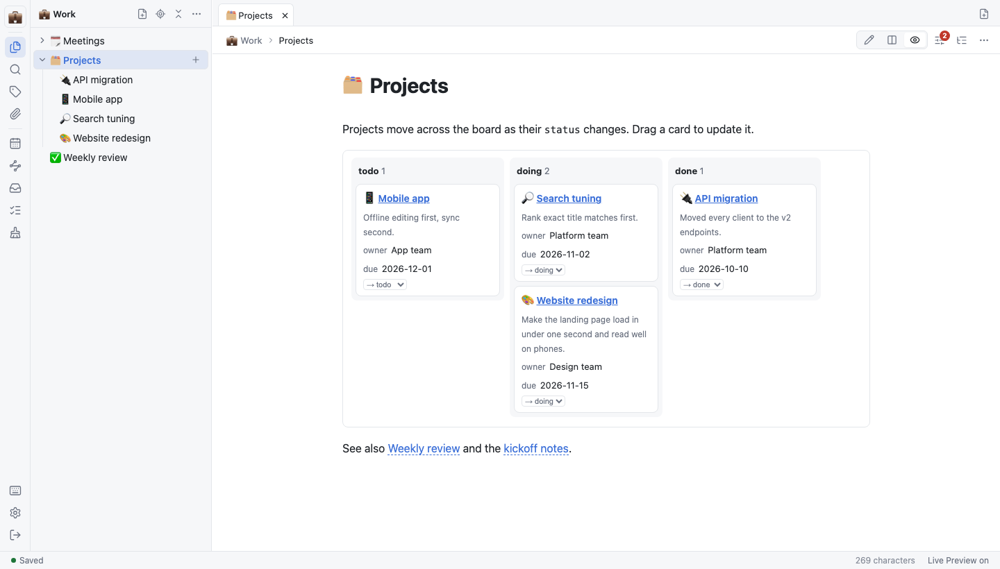

<p align="center"><b>English</b> | <a href="README.ko.md">한국어</a></p>

<h1 align="center">Keyring Notes</h1>

<p align="center">Self-hosted Markdown notes for people who work with AI agents: plain files in Git, shared through per-folder permissions.</p>

<p align="center">
  <a href="https://github.com/jang2162/keyring-notes/releases/latest"></a>
  <a href="https://github.com/jang2162/keyring-notes/actions/workflows/release-macos.yml"></a>
  <a href="LICENSE"></a>
</p>

<p align="center">
  
</p>

## Overview

Most notes apps keep your notes in their own format, and give an AI agent either all of them or none. Keyring Notes keeps every note as a plain Markdown file in a Git-backed vault on your own server. You write in the browser or the desktop app, and each agent gets a token that sees only the folders you allow, over MCP or a REST API. The vault uses Obsidian-style Markdown, so other editors open it as it is. It is for people who self-host their notes and want agents to read and maintain part of them safely.

## Features

- Edit plain Markdown in the browser or the desktop app, with every change kept in Git history.
- Give each AI agent a token limited to the folders and permission levels you choose.
- Review agent edits before they reach the vault.
- Collect web pages and PDFs into an LLM Wiki that agents maintain, with cited sources.
- Turn notes into live tables, kanban boards and charts with widget blocks.
- Use the desktop app without a server, and sync with your server when you want.
- Back up to S3-compatible storage, encrypted before upload.

## Installation

Requirements: Git, and Docker with Compose v2 and BuildKit (the `docker buildx` plugin, included in Docker Desktop).

```bash
git clone https://github.com/jang2162/keyring-notes && cd keyring-notes
docker compose up -d --build
```

Verify that the server answers:

```bash
curl http://127.0.0.1:8787/api/health
```

```text
{"ok":true}
```

The port is published on `127.0.0.1` only, so only this computer can reach it. To reach it from other devices, see [Deploy with Docker](docs/manual/en/how-to/deploy-with-docker.md). You can also [run from source](docs/manual/en/how-to/run-from-source.md) or [use the desktop app](docs/manual/en/how-to/use-the-desktop-app.md) without a server.

## Quick Start

1. Find the one-time setup code in the server log.

   ```bash
   docker compose logs keyring
   ```

   ```text
   keyring-1  | First run: set a password in the web app with this setup code → 4248-441D-E87C
   ```

2. Open `http://127.0.0.1:8787`, enter the setup code and a new password, and click **Set password and start**.
3. Click **New workspace**, then **+ New workspace**, type `Work` and press Enter. Press Esc, click **New note**, type a title and start writing.

The status bar shows **Saved**, and the note is now a Markdown file in `Work/` with its first commit in the vault's history.

## Documentation

- [Getting started](docs/manual/en/getting-started.md)
- [How-to guides](docs/manual/en/how-to/): organize notes, connect agents, build an LLM Wiki, back up and more
- [Configuration](docs/manual/en/configuration.md): environment variables and `.env` keys
- [Reference](docs/manual/en/reference.md): CLI, MCP tools, REST API, file formats and shortcuts
- [Troubleshooting](docs/manual/en/troubleshooting.md)

## License

MIT License. See [LICENSE](LICENSE) for details.

Third-party software included in Keyring Notes is listed with its licenses in **Settings** → **General** → **Open source licenses**, and at `/licenses.txt` on your server.
