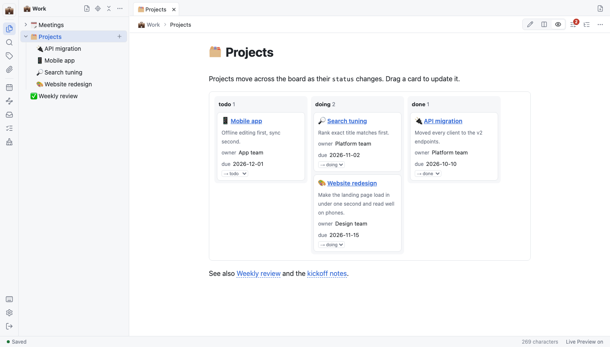

# Use widgets

This guide turns notes into live lists, tables, boards and charts with widget blocks.

It is for people who track projects, tasks or reading lists in their notes.

## Add a widget

Write a fenced code block with the language `widget` and YAML inside. Other editors show it as a plain code block.

````markdown
```widget
type: kanban
from: Work/Projects
group: status
lanes: [todo, doing, done]
show: [owner, due]
```
````

This board shows every note under `Work/Projects` as a card, in a column for its `status` value.



Every option is listed in [Reference](../reference.md#widget-syntax).

## Choose a widget type

| Type | Shows |
| --- | --- |
| `query` | A list of notes |
| `table` | A table with the `show` fields as columns |
| `cards` | A card per note with title, summary and the `show` fields |
| `kanban` | Cards in columns by the value of `group` |
| `tasks` | Tasks from the matching notes. `status: open` (default), `done` or `all` |
| `chart` | A bar or line chart. **Show as table** shows the numbers |
| `plugin` | A widget type you add yourself |

## Edit from the widget

- In `table`, `cards` and `kanban`, click a frontmatter field to edit it in place. Enter saves, Esc cancels, and an empty value deletes the field. Built-in fields such as `title` and `tags` cannot be edited.
- In `kanban`, drag a card to another column, or use the card's select box, to change its `group` field.
- In `tasks`, tick a task to save it in the source note.

If the note changed after the widget was drawn, nothing is overwritten and you are asked to try again. Other fields, comments and the body are left untouched.

## Add a note widget (D-day)

A note widget is a small app inside a note, such as a D-day counter. It keeps its own state in the note, in a `keyring-widget` block. Unlike a `widget` block, it does not look up other notes.

1. Place the cursor where the widget should go.
2. Open the command palette and run **Insert widget**.
3. Choose **D-day**.

The widget appears in place. It shows the name and `D-3`, `D-day` or `D+2` for a date that is three days away, today or two days ago.

To change it, click the widget. Edit the date and the name, then click outside the widget to apply. Press `Esc` to discard your edits. One `Mod+Z` undoes the change, and the file is not rewritten if nothing changed.

To edit the block as Markdown, click **Edit as Markdown** above the widget. Moving the cursor out of the block shows the widget again.

When the block can't be drawn, the source and a one-line message are shown instead. This happens when the JSON is invalid, the widget is not found, or the block needs a newer version of the widget. In the editor, click the message to fix the source.

- A block with `"editable": false` cannot be changed from the widget.
- A block inside a list or a quote, or without a closing fence, stays a plain code block.

The block format is in [Reference](../reference.md#keyring-widget-blocks).

## Add a drawing (Excalidraw)

An Excalidraw sketch is a note widget that keeps the drawing in its own file. The note holds only the file's path.

1. Place the cursor where the drawing should go.
2. Open the command palette and run **Insert widget**.
3. Choose **Excalidraw sketch**.

A file such as `sketch-3f9a.excalidraw.json` is created in the note's attachment folder, and the block records its path in `state.file`.

Draw in place. The drawing is saved when you stop for the autosave delay, the same rule as notes. It is also saved when you leave the widget, hide the window, close the tab or switch the note. With autosave off, the widget shows **Unsaved drawing** until you press `Mod+S`. Closing the tab or switching the note saves the drawing even with autosave off. If it can't be saved, you are asked whether to close without it. Opening a drawing without changing it does not rewrite the file.

Click **Full screen** above the drawing to make it fill the window. `Esc` first does what it does in Excalidraw, such as clearing the selection or finishing text. When there is nothing left for it to do, `Esc` closes full screen.

- **Changed elsewhere:** If the file was changed in another window or on another device, your version is saved next to it as a conflict copy, and the original is read again. Nothing is overwritten.
- **Two panes:** If the same drawing is open twice, drawing in one makes the other read-only with **Being edited in another pane**. It reloads once your strokes are saved. With autosave off, it stays read-only until you press `Mod+S` or close that tab. On a server vault without a connection, it stays read-only until the connection is back.
- **Offline:** The drawing code is downloaded the first time you open a drawing. Without a connection before that, the block's source is shown with **Couldn't load the widget**. After one open, the drawing code loads offline too, until the app has updated twice. On a server vault, the drawing file itself still needs a connection: without one, a drawing you open shows **Couldn't read the drawing**, and one already open is not saved and shows **Couldn't save the file**. It is saved when you draw again or leave the widget after the connection is back. This is different from notes, which are kept on the device until the connection is back.
- **Redrawn widget:** When another pane changes the note while you draw in the preview, or you scroll a long note so the drawing leaves the screen, the drawing is opened again. Saved and unsaved strokes are kept, but Excalidraw's undo history and the scroll position are lost.
- **Keys:** Inside the drawing, only `Esc` and `Mod+S` reach the app. Other app shortcuts don't work while the drawing has the focus.
- **Not available:** Exporting an image, copying as PNG and clipboard permissions are turned off. Links on elements don't open.
- **Fonts:** The Excalifont and Liberation Sans fonts and the CJK font are not included. Text in those fonts is shown in a system font. New text uses Virgil.
- **History:** History view shows the path instead of the drawing. Open the file's history to see older drawings.
- **Files:** Moving or renaming the file updates the block. Deleting the block keeps the file; delete it from the note's files. If the file is missing, the widget shows **File not found** and does not create a new one. The broken-link check can miss a missing drawing when another file ends with the same name.

## Add your own widget type

A widget plugin is one ES module in the server's plugin folder (`KEYRING_PLUGINS_DIR`). See [examples/plugins](../../../../examples/plugins/README.md) for the format and a kanban example.

> [!WARNING]
> Plugins run in the browser with the owner's permissions. Install only code you trust.

## Next steps

- [Use daily notes](use-daily-notes.md): filter widgets by date tags.
- [Connect agents](connect-agents.md): agents run the same queries with MCP `query`.
