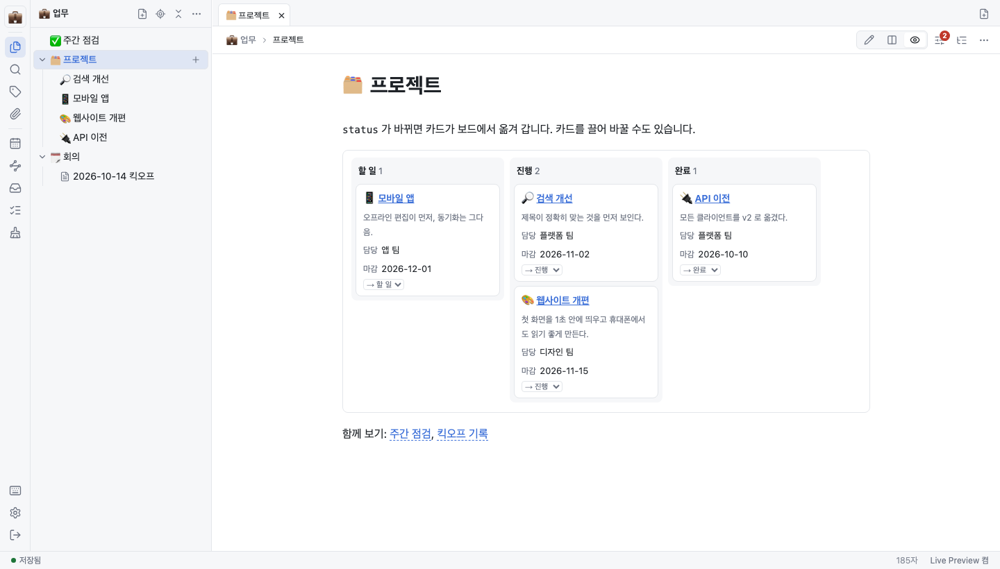

<!-- source: docs/manual/en/how-to/use-widgets.md @ v0.12.0 -->
# 위젯 쓰기

위젯 블록으로 노트를 살아 있는 목록, 표, 보드, 차트로 바꿉니다.

노트로 프로젝트, 할 일, 읽을 목록을 관리하는 분을 위한 문서입니다.

## 위젯 넣기

언어를 `widget` 으로 단 코드 블록 안에 YAML 을 쓰세요. 다른 편집기에서는 평범한 코드 블록으로 보입니다.

````markdown
```widget
type: kanban
from: 업무/프로젝트
group: status
lanes: [할 일, 진행, 완료]
show: [담당, 마감]
```
````

이 보드는 `업무/프로젝트` 아래의 노트를 카드로, `status` 값에 맞는 칸에 보입니다.



모든 옵션은 [참조](../reference.md#위젯-문법)에 있습니다.

## 위젯 종류 고르기

| 종류 | 보이는 것 |
| --- | --- |
| `query` | 노트 목록 |
| `table` | `show` 필드를 열로 둔 표 |
| `cards` | 노트마다 제목, 요약, `show` 필드가 있는 카드 |
| `kanban` | `group` 값별 칸에 놓인 카드 |
| `tasks` | 맞는 노트의 할 일. `status: open`(기본), `done`, `all` |
| `chart` | 막대나 선 차트. **표로 보기**로 숫자를 봅니다 |
| `plugin` | 직접 더한 위젯 종류 |

## 위젯에서 고치기

- `table`, `cards`, `kanban` 에서 프런트매터 필드를 누르면 그 자리에서 고칩니다. Enter 는 저장, Esc 는 취소, 빈 값은 필드 삭제입니다. `title`, `tags` 같은 내장 필드는 고칠 수 없습니다.
- `kanban` 에서 카드를 다른 칸으로 끌거나 카드의 고르기 상자를 쓰면 그 `group` 필드가 바뀝니다.
- `tasks` 에서 할 일을 체크하면 원래 노트에 저장합니다.

위젯을 그린 뒤 노트가 바뀌었으면 덮어쓰지 않고 다시 하라고 알립니다. 다른 필드, 주석, 본문은 건드리지 않습니다.

## 노트 안 위젯 넣기(D-day)

노트 안 위젯은 D-day 계산기처럼 노트 안에 들어가는 작은 앱입니다. 자기 상태를 노트의 `keyring-widget` 블록에 둡니다. `widget` 블록과 달리 다른 노트를 조회하지 않습니다.

1. 위젯을 넣을 자리에 커서를 두세요.
2. 명령 팔레트를 열고 **위젯 넣기**를 실행하세요.
3. **D-day**를 고르세요.

그 자리에 위젯이 보입니다. 이름과 함께 날짜가 사흘 뒤면 `D-3`, 오늘이면 `D-day`, 이틀 전이면 `D+2` 를 보입니다.

고치려면 위젯을 누르세요. 날짜와 이름을 고친 뒤 위젯 밖을 누르면 적용됩니다. `Esc` 를 누르면 고친 내용을 버립니다. `Mod+Z` 한 번이면 되돌아가고, 바꾼 것이 없으면 파일을 다시 쓰지 않습니다.

블록을 마크다운 원문으로 고치려면 위젯 위의 **원문으로 편집**을 누르세요. 커서를 블록 밖으로 옮기면 다시 위젯이 보입니다.

블록을 그릴 수 없으면 원문과 한 줄 안내가 대신 보입니다. JSON 이 올바르지 않거나, 위젯을 찾을 수 없거나, 블록에 위젯의 새 판이 필요할 때입니다. 편집기에서는 안내를 누르면 원문을 고칠 수 있습니다.

- `"editable": false` 인 블록은 위젯에서 바꿀 수 없습니다.
- 목록이나 인용 안에 있거나 닫는 펜스가 없는 블록은 평범한 코드 블록으로 남습니다.

블록 형식은 [참조](../reference.md#keyring-widget-블록)에 있습니다.

## 그림 넣기(Excalidraw)

Excalidraw 스케치는 그림을 따로 파일에 두는 노트 안 위젯입니다. 노트에는 그 파일 경로만 남습니다.

1. 그림을 넣을 자리에 커서를 둡니다.
2. 명령 팔레트를 열고 **위젯 넣기** 를 실행합니다.
3. **Excalidraw 스케치** 를 고릅니다.

노트의 첨부 폴더에 `스케치-3f9a.excalidraw.json` 같은 파일이 생기고, 블록의 `state.file` 에 그 경로가 적힙니다.

그 자리에서 그립니다. 그리다 자동 저장 간격만큼 멈추면 저장됩니다(노트와 같은 규칙). 위젯 밖으로 나가거나, 창을 숨기거나, 탭을 닫거나, 노트를 바꿀 때도 저장됩니다. 자동 저장을 끄면 `Mod+S` 를 누를 때까지 **저장하지 않은 그림** 이 보입니다. 탭을 닫거나 노트를 바꿀 때는 자동 저장이 꺼져 있어도 그림을 저장합니다. 저장하지 못하면 저장하지 않고 닫을지 묻습니다. 그림을 열기만 하고 고치지 않으면 파일을 다시 쓰지 않습니다.

그림 위의 **전체 화면** 을 누르면 창 가득 그립니다. `Esc` 는 먼저 Excalidraw 의 일(선택 풀기, 글 편집 끝내기 등)을 하고, 더 할 일이 없을 때 전체 화면을 닫습니다.

- **다른 곳에서 바뀜:** 다른 창이나 기기에서 파일이 바뀌었으면 고친 내용은 옆에 충돌 사본으로 저장하고 원본을 다시 읽습니다. 덮어쓰지 않습니다.
- **두 칸:** 같은 그림을 두 곳에서 열고 한쪽에서 그리면, 다른 쪽은 **다른 칸에서 고치는 중입니다** 와 함께 보기 전용이 됩니다. 그린 것이 저장되면 다시 읽습니다. 자동 저장을 끄면 `Mod+S` 를 누르거나 그 탭을 닫을 때까지, 서버 볼트에 연결이 없으면 다시 연결될 때까지 보기 전용으로 남습니다.
- **오프라인:** 그림 코드는 처음 열 때 내려받습니다. 그 전에 연결이 없으면 블록 원문과 **위젯을 불러오지 못했습니다** 가 보입니다. 한 번 연 뒤에는 그림 코드가 오프라인에서도 열립니다. 앱이 두 번 업데이트되면 다시 받아야 합니다. 서버 볼트에서는 그림 파일 자체에 연결이 필요합니다. 연결이 없으면 새로 연 그림에는 **그림을 읽지 못했습니다** 가 보이고, 열려 있던 그림은 저장되지 않고 **파일을 저장하지 못했습니다** 가 보입니다. 다시 연결된 뒤 이어 그리거나 위젯 밖으로 나가면 저장됩니다. 연결될 때까지 기기에 두는 노트와 다릅니다.
- **다시 열리는 그림:** 미리보기에서 그리는 중 다른 칸이 노트를 고치거나, 긴 노트에서 그림이 화면 밖으로 스크롤되면 그림이 다시 열립니다. 저장했든 안 했든 그린 것은 남지만, Excalidraw 의 실행 취소 기록과 보던 위치는 사라집니다.
- **키:** 그림 안에서는 `Esc` 와 `Mod+S` 만 앱에 닿습니다. 그림에 포커스가 있는 동안 다른 앱 단축키는 먹지 않습니다.
- **쓸 수 없는 것:** 이미지 내보내기, PNG 로 복사, 클립보드 권한은 꺼져 있습니다. 요소의 링크는 열리지 않습니다.
- **글꼴:** Excalifont·Liberation Sans 글꼴과 한중일 글꼴은 싣지 않습니다. 그 글꼴로 쓴 글은 시스템 글꼴로 보입니다. 새 글은 Virgil 로 씁니다.
- **이력:** 이력 보기에서는 그림 대신 경로가 보입니다. 옛 그림은 그 파일의 이력에서 봅니다.
- **파일:** 파일을 옮기거나 이름을 바꾸면 블록도 고쳐집니다. 블록을 지워도 파일은 남습니다. 노트의 파일 목록에서 지웁니다. 파일이 없으면 **파일을 찾을 수 없습니다** 가 보이고 새로 만들지 않습니다. 깨진 링크 점검은 끝 이름이 같은 다른 파일이 있으면 없는 그림 파일을 놓칠 수 있습니다.

## 위젯 종류 직접 더하기

위젯 플러그인은 서버의 플러그인 폴더(`KEYRING_PLUGINS_DIR`)에 둔 ES 모듈 하나입니다. 형식과 칸반 예제는 [examples/plugins](../../../../examples/plugins/README.ko.md)에 있습니다.

> [!WARNING]
> 플러그인은 브라우저에서 소유자 권한으로 돕니다. 믿을 수 있는 코드만 넣으세요.

## 다음 단계

- [데일리 노트 쓰기](use-daily-notes.md): 날짜 태그로 위젯 거르기
- [에이전트 연결하기](connect-agents.md): 에이전트는 MCP `query` 로 같은 쿼리를 돌립니다
