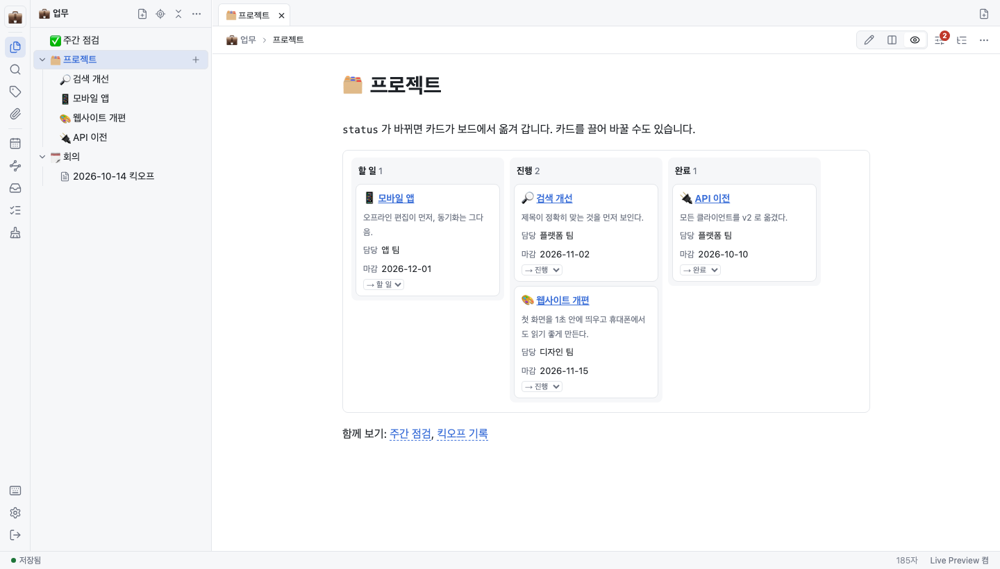

<!-- source: docs/manual/en/how-to/use-widgets.md @ v0.8.5 -->
# 위젯 쓰기

위젯 블록으로 노트를 살아 있는 목록, 표, 보드, 차트로 바꿉니다.

노트로 프로젝트, 할 일, 읽을 목록을 관리하는 분을 위한 문서입니다.

## 위젯 넣기

언어를 `widget` 으로 단 코드 블록 안에 YAML 을 쓰세요. 다른 편집기에서는 평범한 코드 블록으로 보입니다.

````markdown
```widget
type: kanban
from: 업무/프로젝트
group: status
lanes: [할 일, 진행, 완료]
show: [담당, 마감]
```
````

이 보드는 `업무/프로젝트` 아래의 노트를 카드로, `status` 값에 맞는 칸에 보입니다.



모든 옵션은 [참조](../reference.md#위젯-문법)에 있습니다.

## 위젯 종류 고르기

| 종류 | 보이는 것 |
| --- | --- |
| `query` | 노트 목록 |
| `table` | `show` 필드를 열로 둔 표 |
| `cards` | 노트마다 제목, 요약, `show` 필드가 있는 카드 |
| `kanban` | `group` 값별 칸에 놓인 카드 |
| `tasks` | 맞는 노트의 할 일. `status: open`(기본), `done`, `all` |
| `chart` | 막대나 선 차트. **표로 보기**로 숫자를 봅니다 |
| `plugin` | 직접 더한 위젯 종류 |

## 위젯에서 고치기

- `table`, `cards`, `kanban` 에서 프런트매터 필드를 누르면 그 자리에서 고칩니다. Enter 는 저장, Esc 는 취소, 빈 값은 필드 삭제입니다. `title`, `tags` 같은 내장 필드는 고칠 수 없습니다.
- `kanban` 에서 카드를 다른 칸으로 끌거나 카드의 고르기 상자를 쓰면 그 `group` 필드가 바뀝니다.
- `tasks` 에서 할 일을 체크하면 원래 노트에 저장합니다.

위젯을 그린 뒤 노트가 바뀌었으면 덮어쓰지 않고 다시 하라고 알립니다. 다른 필드, 주석, 본문은 건드리지 않습니다.

## 위젯 종류 직접 더하기

위젯 플러그인은 서버의 플러그인 폴더(`KEYRING_PLUGINS_DIR`)에 둔 ES 모듈 하나입니다. 형식과 칸반 예제는 [examples/plugins](../../../../examples/plugins/README.ko.md)에 있습니다.

> [!WARNING]
> 플러그인은 브라우저에서 소유자 권한으로 돕니다. 믿을 수 있는 코드만 넣으세요.

## 다음 단계

- [데일리 노트 쓰기](use-daily-notes.md): 날짜 태그로 위젯 거르기
- [에이전트 연결하기](connect-agents.md): 에이전트는 MCP `query` 로 같은 쿼리를 돌립니다
